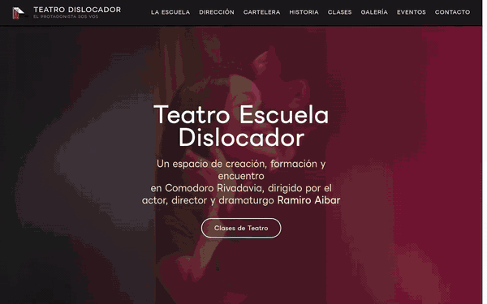
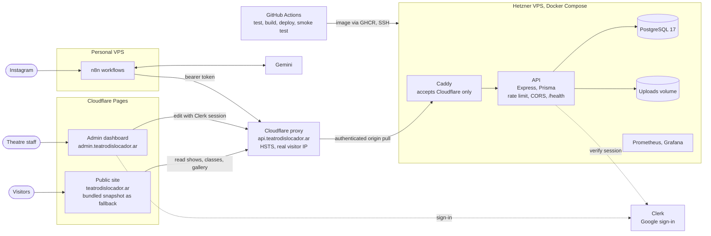

# Teatro Dislocador

[](https://github.com/jonorl/teatro-dislocador/actions/workflows/test.yml)
[](https://github.com/jonorl/teatro-dislocador/actions/workflows/deploy.yml)
[](https://github.com/jonorl/teatro-dislocador/security/code-scanning)
[](https://api.teatrodislocador.ar/health)
[](LICENSE)

The website of Teatro Dislocador, an independent theatre in Comodoro Rivadavia, Argentina.

The monorepo holds three apps: the public site, an admin dashboard for the theatre's staff, and the Node.js API that both of them use. Shows and classes also keep themselves up to date: an n8n workflow reads the theatre's Instagram posts and updates the site through the API.

<p align="center">
  <a href="https://teatrodislocador.ar">
    
  </a>
</p>

## Architecture



- **The site never depends on the API being up.** Every Pages build bundles a snapshot of the content, which the site shows if the API doesn't answer.
- **Only Cloudflare can reach the API.** Caddy requires Cloudflare's origin-pull client certificate, so requests to the server's IP are refused, and the API identifies visitors from Cloudflare's `CF-Connecting-IP` header.
- **Content mostly updates itself.** n8n turns the theatre's Instagram posts into shows and classes through the same API the admin uses, authenticated with its own token.
- **A deploy only counts once it's live.** GitHub Actions runs the tests, ships the image, then waits until `/health` reports the new commit through Cloudflare.

## Project structure

```bash
teatro-dislocador/
├── .github/           # CI and deploy workflows, Dependabot config
├── admin/             # Admin dashboard (React + Vite + Clerk), admin.teatrodislocador.ar
├── docs/              # README media
├── server/            # API (Node.js + Express + Prisma), api.teatrodislocador.ar
│   └── test/          # API tests
└── web/               # Public site (React + Vite), teatrodislocador.ar
```

Each app has its own `package.json`; there is no root workspace.

## Features

### Public site (`/web`)

- Sections for the school, artistic direction, current shows, history, classes, gallery, events, reviews and contact.
- Shows, classes and gallery images come from the API.
- Responsive layout built with Tailwind CSS and shadcn/ui components, with an Embla carousel for the gallery.
- Embedded Google Maps location and links to Facebook, Instagram, X and TikTok.
- **Static fallback.** Every build snapshots shows, classes and gallery images into `web/public/snapshot/`. If the API is unreachable, the site serves the snapshot instead of empty sections. Setting `VITE_DATA_SOURCE=static` in Cloudflare Pages runs the site without the server at all. Refresh the committed copy with `npm run snapshot`.

### Admin dashboard (`/admin`)

- Sign-in through Clerk with Google only. The API then checks the signed-in email against an allowlist in [`server/src/middleware/auth.ts`](server/src/middleware/auth.ts); add a new administrator there.
- Create, edit and delete shows and classes, with a rich-text editor (TinyMCE) for descriptions.
- Gallery management, including uploading up to 12 images at once.

### API (`/server`)

- Express 5 with Prisma ORM on PostgreSQL 17.
- Public `GET` endpoints for shows (`/api/showcase`), classes (`/api/classes`) and gallery (`/api/gallery`); all writes need an administrator.
- Image uploads: JPEG, PNG, WEBP or GIF up to 10 MB each, stored on disk and served from `/uploads`.
- **Authentication.** Admin routes accept a Clerk session from an allowlisted email, or `Authorization: Bearer $AUTOMATION_TOKEN` for the n8n workflow.
- **Rate limiting.** 300 requests per 15 minutes per visitor on `/api`. Requests arrive through Cloudflare and Caddy, so the visitor is identified by Cloudflare's `CF-Connecting-IP` header.
- **Health check.** `GET /health` answers `200` with the deployed commit when the database is reachable and `503` when it isn't. It isn't rate-limited, and checks the database at most every 5 seconds. Docker uses it as the container's `HEALTHCHECK`.
- **CORS.** Only the public site, the admin dashboard and their Cloudflare Pages previews may call the API from a browser. Server-side callers such as n8n are unaffected. The list is in [`server/src/middleware/cors.ts`](server/src/middleware/cors.ts); add any new front-end domain there before using it.

## Instagram automation (n8n)

The theatre announces everything on Instagram, so an n8n workflow keeps the shows and classes in sync with its posts. The workflow runs on the personal VPS, not the Hetzner one, and its export is kept outside this repo.

**Hourly sync**

1. Reads the Instagram token from `n8n_secrets` (Postgres, `agentic_ai` database) and fetches the latest 10 posts.
2. Skips posts already recorded in `InstagramPost` and posts without a caption.
3. Gemini classifies each caption as a new show, an update to an existing one, a class, or nothing, and extracts title, dates, description (HTML) and the event date.
4. Skips past events and decisions below 0.7 confidence.
5. Re-hosts the image through `/api/upload` (photo, first carousel slide, or the reel's cover thumbnail; saved without an image if Instagram withholds it), then creates or updates the show or class with its `instagramId` and `endsAt`.
6. Records every decision, applied or skipped, via `/api/instagram/processed`, and sends a summary to WhatsApp.

**Daily (04:00, Argentina time)**

- `POST /api/instagram/expire-shows` removes Instagram shows 30 days after the show (`endsAt`), and any show without an end date that hasn't been edited for 30 days. Re-saving an undated show in the admin keeps it up for another 30 days.
- `POST /api/maintenance/cleanup-uploads` deletes files in the uploads folder that no show, class or gallery entry references, once they are older than 7 days (the admin uploads an image before the entry is saved).
- A Cloudflare Pages deploy hook rebuilds the site so the static snapshot stays current.

**Weekly (Mondays)**

- Refreshes the long-lived Instagram token (valid 60 days) and stores the new one. The account owner only needs to re-authorise if the token is revoked, for example after an Instagram password change, or if the refresh fails for 60 days.

**Automation endpoints** (all require the bearer token)

| Endpoint | Purpose |
|---|---|
| `GET /api/instagram/processed` | Last 200 processed post IDs, for de-duplication |
| `POST /api/instagram/processed` | Records `{ id, decision }` for a post |
| `POST /api/instagram/expire-shows` | Removes expired shows and returns their titles |
| `POST /api/maintenance/cleanup-uploads` | Lists unused uploaded images; deletes them only with `{ "dryRun": false }` |

**Re-authorising Instagram** (only if the token stops working)

1. The account owner opens `https://www.instagram.com/oauth/authorize?client_id=1075439172000283&redirect_uri=https://teatrodislocador.ar/&response_type=code&scope=instagram_business_basic`, taps "Permitir" and sends back the URL they land on.
2. Within an hour, exchange the `code` for a short-lived token (`POST https://api.instagram.com/oauth/access_token`), then for a 60-day token (`GET https://graph.instagram.com/access_token?grant_type=ig_exchange_token`). Both need the Instagram app secret from the Meta dashboard.
3. Store it: `UPDATE n8n_secrets SET value = '<token>' WHERE key = 'dislocador_ig_token';`

## Tech stack

| Area | Tools |
|---|---|
| Front ends | React 19, TypeScript 6, Vite 8, Tailwind CSS 4; shadcn/ui, Embla and Motion on the public site; Clerk and TinyMCE in the admin |
| API | Node.js 22, Express 5, Prisma 7, PostgreSQL 17, Multer, Clerk |
| Automation | n8n (self-hosted), Google Gemini, Instagram API with Instagram Login (`instagram_business_basic`) |
| Testing | Jest 30, Testing Library, Supertest |
| Hosting | Cloudflare Pages (public site and admin); Hetzner VPS with Docker Compose and Caddy (API and database) |
| Operations | GitHub Actions, GitHub Container Registry, automated database backups, Grafana and Prometheus monitoring |

## Getting started

### Prerequisites

Node.js 22 or later, and Docker if you want to build the server image.

### Install

```bash
git clone https://github.com/jonorl/teatro-dislocador.git
cd teatro-dislocador
cd server && npm install && npx prisma generate
cd ../web && npm install
cd ../admin && npm install
```

### Environment variables

Each app reads a `.env` file in its own folder. None of them is committed.

**`server/.env`**

| Variable | Purpose |
|---|---|
| `DATABASE_URL_DISLOCADOR` | PostgreSQL connection string |
| `PORT_DISLOCADOR` | Port to listen on (default 3000) |
| `MODE` | `PROD` in production; anything else uses the development keys and URLs below |
| `NODE_ENV` | `production` in production. `development` turns off admin authentication, so only use it locally (`npm run dev` sets it for you). |
| `NEXT_PUBLIC_CLERK_PUBLISHABLE_KEY`, `CLERK_SECRET_KEY` | Clerk keys used when `MODE=PROD` |
| `DISLOCADOR_PUBLISHABLEKEY`, `DISLOCADOR_SECRETKEY` | Clerk keys used otherwise |
| `DISLOCADOR_PROD_SERVER_URL`, `DISLOCADOR_DEV_SERVER_URL` | Public base URL used to build links to uploaded images |
| `AUTOMATION_TOKEN` | Bearer token for n8n. Generate with `openssl rand -hex 32` and put the same value in n8n's "Dislocador automation token" credential. Production only. |
| `UPLOAD_DIR` | Optional override of the uploads folder when deleting gallery images |

**`admin/.env`**

| Variable | Purpose |
|---|---|
| `VITE_DISLOCADOR_PROD_PUBLIC_CLERK_PUBLISHABLE_KEY`, `VITE_DISLOCADOR_DEV_PUBLIC_CLERK_PUBLISHABLE_KEY` | Clerk publishable keys for production builds and `npm run dev` |
| `VITE_DISLOCADOR_PROD_BACKEND`, `VITE_DISLOCADOR_DEV_BACKEND` | API base URL, including `/api`, for production builds and `npm run dev` |
| `VITE_TINYMCE_API_KEY` | TinyMCE editor key |

**`web/.env`** (both optional)

| Variable | Purpose |
|---|---|
| `VITE_DATA_SOURCE` | `static` to serve only the snapshot and never call the API |
| `SNAPSHOT_API` | API the snapshot script copies from (default `https://api.teatrodislocador.ar`) |

### Run locally

```bash
cd server && npm run dev   # API on http://localhost:3000, admin auth turned off
cd web && npm run dev      # public site
cd admin && npm run dev    # admin dashboard
```

### Database changes

Schema changes go through Prisma migrations only. On production, apply them through an SSH tunnel to the Hetzner Postgres with `npx prisma migrate deploy`, **before** pushing code that depends on them.

## Testing

Each app has its own Jest suite. Run it from the app's folder:

```bash
npm test                # once
npm run test:watch      # re-run on changes
npm run test:coverage   # with a coverage report
npm run typecheck       # TypeScript, without building
```

- **server:** every route, authentication, rate limiting, CORS and the expiry and cleanup queries. Prisma and Clerk are mocked, so no database or keys are needed.
- **web:** the API-or-snapshot data loading, and the shows and classes sections.
- **admin:** the classes, shows and gallery panels (list, create, edit, upload, delete), toasts, auth headers and backend selection.

## Deployment

- **API:** pushing to `main` with changes under `server/` runs the `Build and Deploy` workflow. It runs the tests first, then builds the Docker image, pushes it to `ghcr.io/jonorl/teatro-dislocador`, then pulls it on the VPS and recreates the container with Docker Compose. Caddy in front handles TLS. A final smoke test waits until `/health` reports the new commit through Cloudflare, then checks the public endpoints and that admin routes still require a login, and fails the run otherwise.
- **Public site and admin:** Cloudflare Pages builds both on every push, with preview deployments for other branches.

## Security and maintenance

- **CI:** the `Test` workflow runs on every push and pull request. It type-checks and tests all three apps, and lints the two front ends.
- **Branch ruleset:** changes to `main` go through a pull request with passing tests and no new high or critical CodeQL alerts. Force-pushes and deletion are blocked; repository admins can bypass.
- **CodeQL:** scans the JavaScript/TypeScript code and the workflows weekly and on every pull request.
- **Dependabot:** security updates as soon as an advisory appears, and version updates every Monday. Minor and patch bumps arrive as one pull request per app, and the Prisma packages move together. Major versions of `@types/node` and Babel, and TypeScript 6.1 or later, are skipped for now; [`.github/dependabot.yml`](.github/dependabot.yml) explains why.
- **Secret scanning** with push protection is on.

## Author

Developed by Jonathan Orlowski. Licensed under the Mozilla Public License 2.0, see [`LICENSE`](LICENSE).
